# Embeddings: caché, búsqueda y purga declarativa

La búsqueda por embeddings es estándar en DER. En el server los embeddings son una **caché simple**: si la huella del texto ya está, se incrementa y se devuelve sin llamar al modelo. Es un plugin JSON como identidad y permisos: `createClient(embeddings, ...)` y `createServer(embeddingsServer, { db, cfg, services })`.

## Tablas

| Tabla | Clave en el plugin | Ruta (solo lectura) | Para qué |
|---|---|---|---|
| `embeddings_cache` | `cache` | `embeddings/entrada(s)` | una fila por referencia y huella; `vector` oculto |
| `embeddings_proyecciones` | `proyecciones` | `embeddings/proyeccion(es)` | la reducción aplicada, para repetirla igual en las consultas |
| `embeddings_contadores` | `contadores` | `embeddings/contador(es)` | hits, misses y purgadas acumulados por modelo y referencia |
| `embeddings_cursores` | `cursores` | `embeddings/cursor(es)` | avance de la alimentación periódica |

Para renombrar con un prefijo (base compartida): `Obj.insert(embeddingsServer, { entities: { cache: { table: "avatar_embeddings_cache" }, ... } })`, igual que en los otros plugins.

Columnas de la caché: `icache`, `huella` (SHA-256 del texto canónico), `modelo`, `dims`, `iproyeccion`, `tipo` (`documento` | `consulta`), `entidad` (plural; `*` si la consulta no tiene), `id` (vacío en consultas), `vector`, `bytes`, `hits`, `fultimohit`, `fcreado`. Modelo y dimensiones son columnas: no hay una tabla por modelo. El texto no se guarda.

**Una fila por referencia.** Dos registros con el mismo texto cuestan una sola llamada al modelo, pero tienen una fila cada uno: así una regla por entidad borra exactamente lo suyo y no deja sin vector al otro. Un documento cuyo texto cambia pierde su fila anterior.

## Operaciones

[](../999-Adjuntos/010-Diagramas/embeber-cache.svg)

| Op (server y client) | Ruta | Qué hace |
|---|---|---|
| `embeber({ items, modelo? })` | `POST embeddings/embeber` | `items`: textos o `{ texto, entidad?, id?, tipo? }`. Devuelve `{ modelo, dims, iproyeccion, vectores, hits, misses }` |
| `buscar({ q, entidades?, limite?, filtros?, filtroIndice? })` | `POST embeddings/buscar` | `{ q, semantica, resultados: [{ entidad, id, score, origen }] }` |
| `estadisticas()` | `GET embeddings/estadisticas` | hits, misses, tasa, filas, bytes y purgadas: total, por modelo y por referencia |
| `purgar({ simular?, reglas?, solo?, ahora? })` | `POST embeddings/purgar` | informe con pasos, muestra, tamaño antes y después, presión |
| `reglas()` | `GET embeddings/reglas` | orden efectivo, errores contra las entidades y proyecciones vigentes |
| `alimentar({ entidad?, lote?, reiniciar? })` | `POST embeddings/alimentar` | una tanda por entidad desde su cursor |
| `indexar(docs, modelo?)` (server) | — | embeber documentos y subirlos al índice externo |
| `olvidar(entidad, ids)` (server) | — | borrar referencias (hook `afterDelete`) y sacarlas del índice |

Todas las rutas llevan `security: true`. `buscar` devuelve solo `entidad` + `id`: quien muestra el resultado resuelve la visibilidad. Con varios inquilinos usa `filtros` por entidad (where de DER), que se aplica a todas las fuentes, y llama la op en proceso desde tu propia ruta.

## Proveedor e índice inyectables

Lo que no es JSON va en `services` y `cfg` lo nombra por clave. Un proveedor es `{ embeber(textos, modelo) }`; un índice es `{ dims?, buscar(vector, { topK, entidades, filtro }), subir?(docs), borrar?(refs) }`.

```ts
const emb = createServer(embeddingsServer, { db, cfg, services: { ai: workersAi(env.AI), vectores: vectorizeIndice(env.VECTORES, { dims: 1024 }) } });
```

Sin índice, `buscar` calcula coseno sobre las filas `documento` de la caché (hasta `maxCandidatos`, las más recientes): funciona en D1 sin Vectorize. Sin proveedor, un hit sigue sirviendo, `embeber` de un texto nuevo responde 503 y `buscar` degrada a texto (`semantica: false`).

## Prioridad de resultados

1. `exacta`: una columna de `busqueda.exactas` es igual a la consulta (sin mayúsculas), o el documento completo tiene su misma huella.
2. `contiene`: una de esas columnas contiene la consulta.
3. `embedding`: por similitud, con `minScore`.

Un mismo registro queda con su mejor origen.

## Reducción

Por modelo, en `reduccion`:

| Campo | Valores | Efecto |
|---|---|---|
| `metodo` | `aleatoria` (default), `truncar`, `ninguna` | `aleatoria`: proyección dispersa con semilla, sirve para modelos no entrenados para truncarse, como bge-m3. `truncar`: primeras N dimensiones, para modelos que sí lo admiten |
| `dims` | menor que las del modelo | dimensiones guardadas |
| `decimales` | 1 a 4 | 1-2: un byte por dimensión; 3-4: dos. Sin decimales, float32 |
| `semilla` | entero | define la matriz |

El vector se normaliza (L2), se proyecta, se normaliza otra vez y se redondea. La proyección queda en `embeddings_proyecciones` con un id derivado de sus parámetros; cada fila guarda `iproyeccion`, y documentos y consultas pasan por la misma función. Cambiar la reducción crea otra proyección: las filas viejas no se mezclan y el paso `obsoletas` las retira.

**Sugerencia:** `{ "metodo": "aleatoria", "dims": 256, "decimales": 3 }`. Una fila de 1024 float32 ocupa 5462 caracteres; reducida, 683 (12.5 %). No uses 1 o 2 decimales con muchas dimensiones: los componentes de un vector unitario de 1024 rondan 0.03 y se perderían. La prueba del repo conserva el vecino más cercano en datos sintéticos; mide el recall con tus datos antes de activarla en producción.

Un índice externo debe tener las dimensiones de la proyección. `vectorizeIndice(binding, { dims })` hace que `buscar` falle con un mensaje claro si no coinciden. Un front que hornea vectores puede leer la proyección de `embeddings/proyecciones`, pero hoy solo `proyectar` en TypeScript la implementa.

## Reglas de purga

Las reglas son datos. Zod valida su forma, y sus columnas se validan contra la definición de la entidad en `seed()`, en `purgar` y en `GET embeddings/reglas`. No hay SQL libre ni `eval`: los identificadores salen del metadata de los controllers y los valores van como parámetros.

```json
{ "nombre": "mensajes-inactivos", "alcance": { "entidad": "mensajes" }, "sinHitsDias": 3, "donde": [{ "columna": "bactivo", "op": "eq", "valor": false }] }
```

| Campo | Significado |
|---|---|
| `alcance` | `entidad` (plural), `tipo`, `modelo`. Vacío: toda la caché |
| `sinHitsDias` | último hit (o creación si nunca hubo) más viejo que N días |
| `edadDias` | creación más vieja que N días |
| `hitsMenorQue` | menos de N hits |
| `donde` | condiciones en AND sobre la entidad: `eq`, `ne`, `lt`, `lte`, `gt`, `gte`, `in`, `nulo`, `noNulo`, `masDeDias` |
| `huerfanos` | el registro ya no existe. Junto a `donde` es O: cumple `donde` o ya no existe |
| `todo` | confirma borrar todo el alcance: una regla sin criterio se rechaza |
| `soloPresion` | solo corre bajo presión |
| `excluirDeGeneral` | su alcance no lo toca el tiempo general |
| `prioridad`, `activa` | orden (menor primero, default 100) y encendido |

Los criterios van en AND. `donde` y `huerfanos` exigen `alcance.entidad` con pk simple en la misma base y aplican a documentos. Una columna oculta, virtual o json se rechaza. Máximo 20 reglas y 90 parámetros en total, por el límite de 100 de D1.

## Corrida

1. `obsoletas`: filas de una proyección que ya no es la vigente de su modelo (`"obsoletas": false` la apaga).
2. Reglas normales por prioridad.
3. `general`: filas sin hits en `purga.general.sinHitsDias`, salvo los alcances excluidos.
4. Si la caché sigue sobre `maxFilas` o `maxBytes`: reglas de `presion.orden` y, si `ultimoRecurso` es `lru`, cualquier fila, siempre lo menos usado primero, hasta `objetivoPct`.

`lote` × `maxLotes` acota una corrida; si se agota, el informe trae `pendiente: true` y la siguiente sigue. `solo` limita a unos pasos por nombre (`presion` activa la fase de presión). `reglas` reemplaza las configuradas, útil para probar una regla antes de escribirla en el JSON.

`{ "simular": true }` recorre el mismo plan contando, excluye de cada paso lo que tomaron los anteriores y trae una muestra de cinco filas. Solo en la fase de presión la cifra parcial de un paso va marcada `estimado: true`.

Por cron, en el Worker (DER no define `scheduled`; lo exporta el consumidor):

```ts
export default {
  fetch,
  scheduled(_e, env, ctx) {
    ctx.waitUntil(appDe(env).then(async ({ emb }) => { await emb.alimentar(); await emb.purgar(); }));
  },
};
```

## Depuración

```ts
const emb = createClient(embeddings, { baseUrl: "/api", headers: auth.headers });
await emb.controllers.cache.query({ where: { entidad: "mensajes", hits: { gt: 3 } }, orderBy: "-hits" }); // JSON de DER, sin vector
await emb.controllers.contadores.query({ where: { entidad: "productos" } });
await emb.estadisticas();
await emb.reglas();
await emb.purgar({ simular: true });
```

## D1

Sin transacciones: una caída entre escrituras deja como mucho un contador sin sumar o una fila por repetir, y la caché se recupera sola. Toda sentencia va troceada bajo 100 parámetros. Un `embeber` con un lote de misses hace varias consultas; tenlo en cuenta en el límite de consultas por invocación. No hay tipo binario en DER: el vector es texto base64url, un tercio más que los bytes.
