# Gestión de archivos

Carpetas y archivos como en un sistema de ficheros, con CRUD, árbol, URLs firmadas y relación libre con cualquier tabla. DER no conoce ningún servicio de almacenamiento: el consumidor vincula un `AlmacenArchivos` con `subir`, `bajar` y `borrar`, y puede cambiarlo sin tocar nada más.

## Entidades

| Entidad | Tabla | Columnas propias |
|---|---|---|
| `carpetas` | `archivos_carpetas` | `icarpeta`, `ipadre`, `nombre`, `ruta` |
| `archivos` | `archivos` | `iarchivo`, `icarpeta`, `nombre`, `clave`, `mime`, `bytes`, `ancho`, `alto`, `duracion`, `origin`, `idorigin` |

Las dos llevan las columnas de auditoría: `propietario_tipo`, `propietario`, `apporigin`, `iporigin`, `fhcre` y `fhmod`.

**Relación libre:** `origin` nombra la tabla u origen y `idorigin` la fila (`errores` / `17`). Índice por `(origin, idorigin)`. No hay FK rígida: cualquier tabla presente o futura se relaciona sin migrar.

**Propiedad:** el dueño puede ser un usuario, una página (`propietario_tipo: "pagina"`, con su ruta) o nadie.

## Flujo de una subida

La clave queda `<prefijo>/<año>/<mes>/<uuid>-<nombre seguro>`.

## Descarga

`publico(fila, ctx)` da una URL `archivos/descarga?clave=&exp=&sig=` firmada con HMAC-SHA256 y `ttlSeg` de vida (900 por defecto). Es pública para que sirva en `` y `<audio>`, que no mandan `Authorization`.

## Para un explorador de archivos

`GET archivos/arbol[?icarpeta=]` devuelve `{ carpeta, carpetas, archivos }` ya filtrado por lo que la sesión puede ver. Con eso, `mover` y el CRUD de carpetas, un web component puede pintar carpetas y archivos sin más endpoints.

## Configuración

| Clave | Default | Qué es |
|---|---|---|
| `secret` | — | firma de las URLs (`env:`) |
| `ttlSeg` | 900 | vida de una URL firmada |
| `maxMb` | 30 | tamaño máximo sin política |
