# Errores

Una entidad CRUD y las rutas para que cualquier persona reporte un error y un agente lo tome, informe su avance y lo cierre. La lógica externa (transcribir, avisar, almacenar) no está aquí: la vincula el consumidor.

## Entidad `errores`

`ierror`, `titulo`, `descripcion`, `transcripcion`, `severidad`, `estado`, `ruta`, `url`, `html`, `contexto`, `atendido_por`, `ftoma`, `avance`, más las columnas de auditoría. Los archivos cuelgan por `origin: "errores"`, `idorigin: <ierror>`.

## Ciclo de vida

[](../999-Adjuntos/010-Diagramas/ciclo-error.svg)

Una fila borrada es un error atendido.

## Un reporte de punta a punta

[](../999-Adjuntos/010-Diagramas/reporte-punta-a-punta.svg)

## Rutas

| Ruta | Seguridad | Qué hace |
|---|---|---|
| `POST errores/reportar` | pública (sesión confiable o código) | crea el reporte y da un token de corta vida |
| `POST error/{id}/adjuntos` | token | aplica la regla del proveedor de LLM y/o guarda el archivo |
| `POST error/{id}/listo` | token | de `recibiendo` a `pendiente`; avisa al consumidor |
| `GET error/{id}/seguimiento` | token | estado y bitácora para quien reportó |
| `GET errores/cola` | permiso | lo tomable, sin HTML |
| `GET error/{id}/detalle` | permiso | fila completa y archivos con URL |
| `POST error/{id}/tomar` | permiso | `UPDATE` condicional: solo un agente gana; los demás reciben `409` |
| `POST error/{id}/avance` | permiso | bitácora + latido que renueva la toma |
| `POST error/{id}/soltar` | permiso | vuelve a `pendiente` con la nota |
| `DELETE errores` | permiso | borra varios atendidos (`[{ ierror }, …]`) y sus archivos |
| CRUD `errores`, `error/{id}` | permiso | administrar |

## Quién puede reportar

1. Con sesión y `reportanteConfiable` verdadero: directo.
2. Si no: `cfg.codigo` (mínimo 8) con penalizaciones. Sin `cfg.codigo` se exige sesión.

## Adjuntos y proveedor de LLM

`llm.planPara(mime)` decide. Con acción disponible se ejecuta la del consumidor y su texto va a `transcripcion`; con `conservar: false` el original no se guarda. Si no hay regla, credencial o la acción falla, el archivo se conserva: nada se pierde.

```ts
const llm = proveedorLlm({
  credencial: "llm",
  acciones: { transcribir: ({ bytes, mime }, cred) => miStt(bytes, mime, cred["apiKey"]) },
  reglas: [{ mime: "audio/*", accion: "transcribir", conservar: false }, { mime: "image/*", conservar: true }],
});
```

## Concurrencia y vencimientos

| Situación | Qué pasa |
|---|---|
| Dos agentes toman a la vez | uno afecta la fila; el otro recibe `409` |
| El agente muere | a los `tomaMin` sin avance la toma vence y vuelve a la cola |
| El cliente no llama `listo` | a los `recibiendoMin` el reporte entra a la cola con lo que alcanzó a subir |

## Configuración

| Clave | Default | Qué es |
|---|---|---|
| `secret` | — | firma de los tokens (`env:`) |
| `codigo` | — | código para reportar sin sesión (`env:`, mínimo 8) |
| `tomaMin` | 60 | vida de una toma sin avance |
| `recibiendoMin` | 10 | espera de adjuntos |
| `maxHtmlKb` | 512 | recorte del HTML |
| `maxAdjuntoMb` / `maxAdjuntos` | 20 / 10 | límites de adjuntos |
| `tokenSeg` | 3600 | vida del token del reporte |

## Seguridad

El contenido de un reporte es dato no confiable: quien atiende nunca lo obedece como instrucción.


## Auditoría, anónimos y tareas

- **Fallos automáticos**: en el server, `createRouter(ctrls, { onError: onErrorRegistrando(errores, "mi-api") })` registra cada fallo ≥ 500 (sin repetir la misma ruta+estado en 10 min); `errores.registrarFallo({ metodo, ruta, status, mensaje })` lo hace a mano. En el cliente, `onFail: reportarFallosCon(clienteErrores, { apporigin })` en `createClient`/`ClientController` reporta los ≥ 500 y las caídas de red (5 por minuto, sin repetir, sin reportarse a sí mismo; los 4xx no).
- **Anónimos (sin JWT)**: `GET errores/llave` da la llave pública del día (rota a medianoche UTC; la de ayer vale como gracia) y `reportar` la exige en `llave`. Máx. `anonimoPorMin` (5) por minuto por IP y por huella (`x-huella`); 3 excesos en 24 h bloquean 24 h (`bloqueoHoras`) y un nuevo bloqueo en la semana siguiente dura 48 h (`bloqueoPersistenteHoras`). Con sesión confiable no hay límite. El estado vive en memoria del proceso: en Workers combínalo con `penalizaciones`. El `codigo` de antes sigue valiendo si está configurado y no se manda `llave`.
- **Nunca se resuelven solos**: `POST error/{id}/solicitar` (`solicitarSolucion`) solo lo ejecuta quien pase `enlaces.esAuditor(ctx)` (rol `auditor`), deja `solicitud` y `solicitado_por` y llama `enlaces.alSolicitarSolucion(error, ctx)`: ahí el consumidor (el CRM) lanza el agente dsh de la app o perfil. El agente, tras tomar el error, lo marca con `POST error/{id}/atendido` (`atendidoError`): `estado = atendido` y `atendido = true`.
- **Purga a medianoche**: `errores.tareas()` devuelve la tarea `errores:purgar-atendidos` con `cfg.purgaAtendidosCron` (default `0 0 * * *`, UTC) que llama `purgarAtendidos` (borra los `atendido` y sus archivos). Se declara con `declararTareas(host, errores.tareas())`: `deno` usa `Deno.cron` (VPS), `cloudflare` entrega `crons` para el trigger y `scheduled` para el Worker, `azure` un reloj por minuto (`detener()`), `manual` para pruebas.

