# Penalizaciones

Tabla `penalizaciones (id, intentos, fhmod)`: un id de vector y los últimos intentos fallidos en JSON. Solo lectura por API; se usa desde el server con `verificar`, `fallo` y `acierto`.

## Reglas

| Fallo n.º | 1 | 2 | 3 | 4 | 5 | 6 | 7 | 8 en adelante |
|---|---|---|---|---|---|---|---|---|
| Minutos | 0 | 0 | 5 | 10 | 15 | 20 | 25 | 30 |

- Decide el vector de la IP; sin IP decide el global.
- Con `umbralGlobal` (10) fallos entre todos en `ventanaGlobalMin` (60) se ignora la IP y decide el global: señal de fuerza bruta.
- Un intento rechazado por estar penalizado no cuenta.
- Durante la penalización ni el secreto correcto pasa.
- Un acierto limpia la IP; los fallos caducan a los `ventanaMin` (1440).
