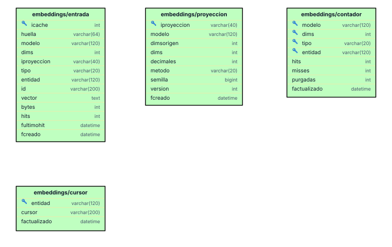

# Modelo de datos de los plugins

## Relaciones

- `archivos.icarpeta` → `archivos_carpetas.icarpeta`; `archivos_carpetas.ipadre` → `archivos_carpetas.icarpeta` (árbol).
- **Relación libre:** `archivos.origin` + `archivos.idorigin` apuntan a una fila de cualquier tabla (`errores` / `<ierror>`). No se dibuja como FK porque no lo es.
- **Propiedad:** `propietario_tipo` + `propietario`: un usuario, una página con su ruta o nadie. Tampoco es FK.
- `penalizaciones` no se relaciona con nada: su `id` es el vector (`errores:ip:<ip>`, `errores:global`).

## Auditoría común

`archivos`, `archivos_carpetas` y `errores` esparcen `COLUMNAS_AUDITORIA`: `propietario_tipo`, `propietario`, `apporigin`, `iporigin`, `fhcre`, `fhmod`.

## Archivos, errores y penalizaciones

## Identidad y permisos

## Embeddings

